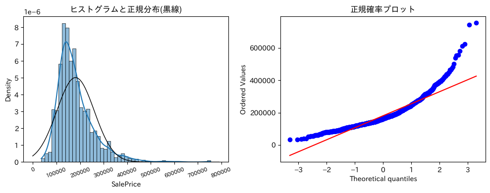
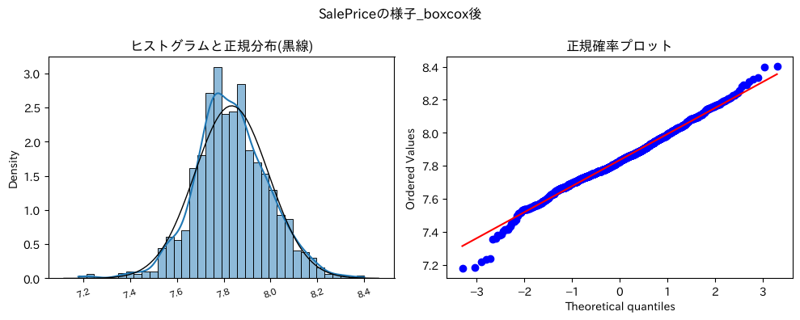

# Kaggle House Prices 住宅価格予測

[](https://github.com/T0bbuT/kaggle_house_price/actions/workflows/notebooks.yml)


Kaggle のコンペ [House Prices - Advanced Regression Techniques](https://www.kaggle.com/competitions/house-prices-advanced-regression-techniques) に取り組んだ分析です。
米国アイオワ州エイムズの住宅 1,460 件・79 個の特徴量から販売価格（`SalePrice`）を予測します。

## 結果

5-fold クロスバリデーションでの評価です（評価指標はコンペと同じ **対数価格の RMSE**、補助的に MAPE）。

| モデル | CV RMSE（対数価格） | CV MAPE | ノートブック |
|---|---|---|---|
| **Lasso**（Optuna でチューニング） | **0.1112** | **7.97%** | [02](notebooks/02_tuned_models.ipynb) |
| Ridge（Optuna でチューニング） | 0.1122 | 8.00% | [02](notebooks/02_tuned_models.ipynb) |
| LightGBM（Optuna でチューニング） | 0.1189 | 8.30% | [02](notebooks/02_tuned_models.ipynb) |
| Ridge（グリッドサーチ、ベースライン）※ | 0.1138 | – | [01](notebooks/01_baseline.ipynb) |

※ 01 は前処理が異なり、学習データの 80% に対する 5-fold CV の値です。

- 予測価格は平均して実際の価格から約 8% ずれる水準です。
- 目的変数・特徴量の分布を整えたことで、線形モデル（Lasso / Ridge）が勾配ブースティング（LightGBM）をわずかに上回りました。
- 乱数シードを固定しているため、同じ環境で実行すれば同じ数値が再現されます。

<p>
  
  
</p>

左: 元の `SalePrice` は右に大きく歪んでいる（歪度 1.88）。右: Box-Cox 変換後はほぼ正規分布に近づいた。

## 分析の流れ

| ノートブック | 内容 |
|---|---|
| [01_baseline.ipynb](notebooks/01_baseline.ipynb) | 教材に沿った初期版。EDA → 欠損値補完 → 外れ値除去 → 対数変換・Box-Cox 変換 → 7 種類のモデル比較 → Ridge のグリッドサーチ |
| [02_tuned_models.ipynb](notebooks/02_tuned_models.ipynb) | 01 を踏まえた改良版。前処理を整理し直し、特徴量を追加して LightGBM / Ridge / Lasso を Optuna でチューニング |

02 の主な処理:

1. **EDA**: 目的変数の分布、相関係数、相関の高い特徴量との散布図（plotly）
2. **外れ値除去**: 居住面積（`GrLivArea`）が大きいのに価格が極端に低い 2 件を除外
3. **欠損値補完**: 「設備がない」ことを表す欠損は `"None"` / `0`、`LotFrontage` は地域（`Neighborhood`）ごとの中央値、その他は最頻値。ほぼ単一値の列（`PoolQC`, `Utilities`, `PoolArea`）は削除
4. **特徴量エンジニアリング**: 総床面積 `TotalSF`、総浴室数 `TotalBathrooms`、ポーチ総面積 `TotalPorchSF`、2 階・ガレージ・地下室・暖炉の有無フラグなど
5. **エンコーディング**: 品質・状態など順序のあるカテゴリは Ordinal Encoding、それ以外は One-hot Encoding
6. **分布の調整**: 目的変数は Box-Cox 変換、歪度 0.75 超の特徴量は Yeo-Johnson 変換
7. **モデリング**: 5-fold CV を目的関数にして Optuna（TPE, 各 50 試行）でハイパーパラメータ探索し、最良パラメータで提出用 CSV を作成

## 環境構築と実行

パッケージ管理には [uv](https://docs.astral.sh/uv/) を使っています。依存パッケージのバージョンは `uv.lock` で固定しているので、誰の環境でも同じ構成が再現できます。Python 3.11 も uv が自動で用意します。

### 1. uv をインストール

```bash
# macOS / Linux
curl -LsSf https://astral.sh/uv/install.sh | sh

# Windows (PowerShell)
powershell -ExecutionPolicy ByPass -c "irm https://astral.sh/uv/install.ps1 | iex"
```

### 2. リポジトリを取得して環境を作る

```bash
git clone https://github.com/T0bbuT/kaggle_house_price.git
cd kaggle_house_price
uv sync
```

`.venv/` に仮想環境が作られます。データ（`data/input/`）はリポジトリに含まれているため、別途ダウンロードは不要です。

### 3. ノートブックを実行

```bash
# JupyterLab で開く
uv run jupyter lab

# または、コマンドラインで最初から最後まで実行する（02 は数分かかります）
uv run jupyter nbconvert --to notebook --execute notebooks/02_tuned_models.ipynb --output-dir outputs/executed
```

VS Code を使う場合は、ノートブックのカーネルに `.venv` の Python を選択してください。

提出用 CSV は `outputs/submissions/` に出力されます（`outputs/` は Git 管理外）。

GitHub Actions でも push / PR ごとに両方のノートブックを最初から実行し、壊れていないことを確認しています。

## ディレクトリ構成

```
.
├── data/
│   └── input/               # コンペ配布データ（train.csv, test.csv, sample_submission.csv）
├── docs/
│   ├── data_description.txt     # 公式の特徴量説明（英語）
│   ├── data_description_jp.csv  # 特徴量説明の日本語訳（ノートブックから参照）
│   ├── images/                  # README 用の図
│   └── notes/                   # 分析中の作業メモ
├── notebooks/
│   ├── 01_baseline.ipynb
│   └── 02_tuned_models.ipynb
├── outputs/                 # ノートブックの出力先（Git 管理外）
├── pyproject.toml           # 依存パッケージの定義
└── uv.lock                  # 依存パッケージのバージョン固定
```

ノートブックは出力をクリアした状態でコミットしています。

## 振り返り

**工夫した点**

- 特徴量が多く英語なので、日本語訳の一覧表（`docs/data_description_jp.csv`）を作り、欠損値の集計表と突き合わせながら補完方法を決めた
- データ中の `NA` が「欠損」ではなく「設備がない」を意味する列が多く、列ごとに意味を確認して `"None"` / `0` で補完した
- 外れ値の特定には plotly のインタラクティブな散布図を使い、該当する行を直接確認した

**課題と今後の改善案**

- `GarageYrBlt`（ガレージ建築年）の欠損をガレージなしとして 0 で補完したが、より適切な扱いがありそう
- `LotFrontage` の補完を、専用の予測モデルで行う方法も試したい
- ドメイン知識に基づく特徴量エンジニアリングや、複数モデルのアンサンブルで精度向上の余地がある

詳しい作業メモは [docs/notes/](docs/notes/) にあります。
